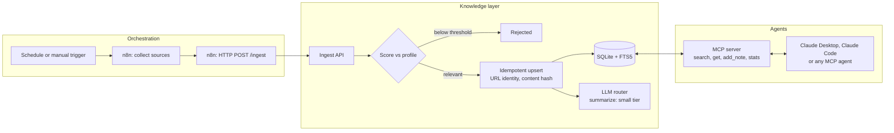

# Lumina OS (demo)

Lumina OS is a self-hosted, multi-agent AI operating layer I built to run my own operations.
n8n orchestrates scheduled work, agents share one knowledge base through an MCP server, and a router sends each LLM call to the cheapest model that can handle it.
This repository is a runnable, sanitized demo of that architecture with synthetic data. It contains no production configuration.

## Architecture



The loop closes when an agent writes a decision back with `add_note`: the next scout run and every other agent start from what was learned.

## Engineering decisions

| Decision | Why |
|---|---|
| n8n orchestrates, Python decides | Workflows stay readable and observable in the n8n execution log. Business logic lives in one tested codebase instead of being split across Code nodes. |
| Identity by URL, freshness by content hash | Re-running any pipeline is safe. Only changed sources are rewritten, so the knowledge base updates itself without duplicates. |
| SQLite FTS5 with BM25 | Native full-text ranking with zero extra services. The storage layer is one module, so moving to Postgres and pgvector is a local change. |
| MCP as the single access path for agents | Every agent gets the same tools and the same context. No prompt stuffing, no per-agent copy of the data. |
| Route LLM calls by task, not by agent | Classification and summaries go to a small model, planning and review to a large one. Cost follows the task. Each tier is named by an environment variable; the demo ships only the offline provider, and `router.complete` is the extension point for real ones. |
| Offline provider by default | The demo and the tests are deterministic and run without any API key. |
| User input quoted before FTS5 | Search queries can never be parsed as query syntax, so malformed input returns results or nothing, never an error. |
| Validate the whole batch, then write it in one transaction | One malformed item rejects the batch with a 400 and nothing is written, so a retry from n8n is always safe. |

## Quickstart

Requires [uv](https://docs.astral.sh/uv/). It installs a compatible Python and the one direct dependency (`mcp`) for you.

```bash
git clone https://github.com/frescatzi/lumina-os-demo.git
cd lumina-os-demo
uv run lumina demo
```

Expected output on the first run: the scout ingests 5 items and rejects 3: two off-topic ones and one on-topic item that matches too few profile keywords (the threshold at work). A second run reports everything `unchanged`, and a changed source is `updated` in place. Then two searches run against the knowledge base.

Other commands:

```bash
uv run lumina search "agent orchestration"   # query the knowledge base
uv run lumina serve                          # ingest API on 127.0.0.1:8787 for n8n
uv run lumina mcp                            # MCP server on stdio
uv run python -m unittest discover tests     # test suite
```

### Connect an MCP client

Add this to your MCP client configuration (for example Claude Desktop), with the absolute path to your clone:

```json
{
  "mcpServers": {
    "lumina-knowledge": {
      "command": "uv",
      "args": ["run", "--directory", "/absolute/path/to/lumina-os-demo", "lumina", "mcp"]
    }
  }
}
```

### Run the n8n workflows (optional)

The two workflows in `workflows/` import into any n8n instance (Workflows, then Import from file):

- `scout-synthetic.json`: synthetic sources, manual or every 6 hours.
- `scout-arxiv-rss.json`: real public data from the arXiv multi-agent systems feed.

Start `uv run lumina serve` first. The workflows post to `http://127.0.0.1:8787/ingest`, which works when n8n runs natively on the same machine (for example `npx n8n`). If n8n runs in Docker, point the HTTP Request node at an address the container can reach (`host.docker.internal` on Docker Desktop, or `--add-host=host.docker.internal:host-gateway` on Linux) and bind `lumina serve --host` to that interface only. The API has no authentication: never bind it to a public interface.

The workflows pass n8n structural validation. The Python quickstart above is the verified path; the n8n import is not part of the automated tests.

## Repository layout

```
lumina/kb.py          knowledge base: score, idempotent ingest, BM25 search
lumina/router.py      task-to-model-tier routing, offline provider
lumina/api.py         HTTP ingest endpoint called by n8n (stdlib only)
lumina/mcp_server.py  MCP tools over the knowledge base
lumina/__main__.py    command line
workflows/            n8n workflow exports
data/seed/            synthetic feed and relevance profile
tests/                unit and integration tests
```

## What this demonstrates

- **Business process to IT system.** The scout is a business rule (what is relevant, what is new, what changed) turned into an explicit, testable pipeline. The same method maps an ERP process such as SAP procure-to-pay onto agent steps: each business control becomes an explicit check, and an LLM is used only where judgment is needed.
- **Applied AI orchestration.** Scheduling, agents, shared memory and model routing are separate layers with narrow contracts, so each one can be replaced without touching the others.
- **Production habits in a small codebase.** Idempotent writes, input validation at the trust boundary, deterministic tests, and no secret required to run.

## Contact

- Katel Tindjou (Karter)
- LinkedIn: [linkedin.com/in/kateltindjou](https://www.linkedin.com/in/kateltindjou/)
- Upwork: [Upwork profile](https://www.upwork.com/freelancers/~01cb483758d968e583)

## License

MIT, see [LICENSE](LICENSE).
